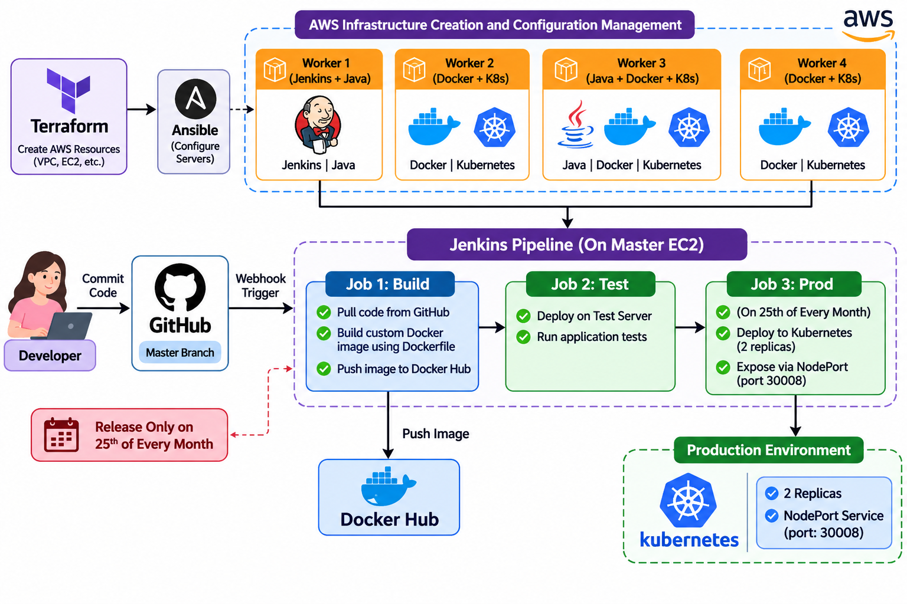

# DevOps Capstone Project 2

Standalone architecture for Project 2, based on the provided specifications.

## Architecture

## Components

- **Terraform** creates AWS infrastructure, including VPC and EC2 resources.
- **Ansible** configures the servers.
- **Four EC2 workers:**
  - Worker 1: Jenkins and Java
  - Worker 2: Docker and Kubernetes
  - Worker 3: Java, Docker, and Kubernetes
  - Worker 4: Docker and Kubernetes
- **GitHub Master branch** sends a webhook to Jenkins when code is committed.
- **Jenkins pipeline:** Build, Test, and Prod stages.
- **Build:** Jenkins checks out the source, builds a custom Docker image using a Dockerfile, and pushes it to Docker Hub.
- **Test:** Deploys to the test server and runs application tests.
- **Production:** Monthly release on the 25th; deploys to Kubernetes with 2 replicas and exposes the application through NodePort `30008`.

## Image

The architecture image is stored in this repository as [`architecture.png`](architecture.png) and displayed above.
